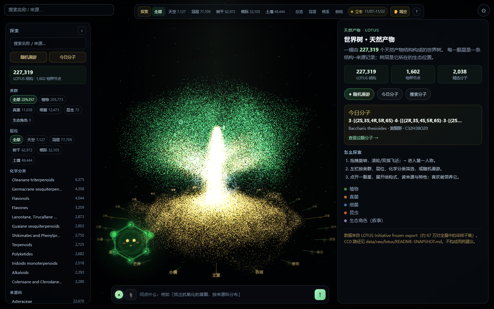
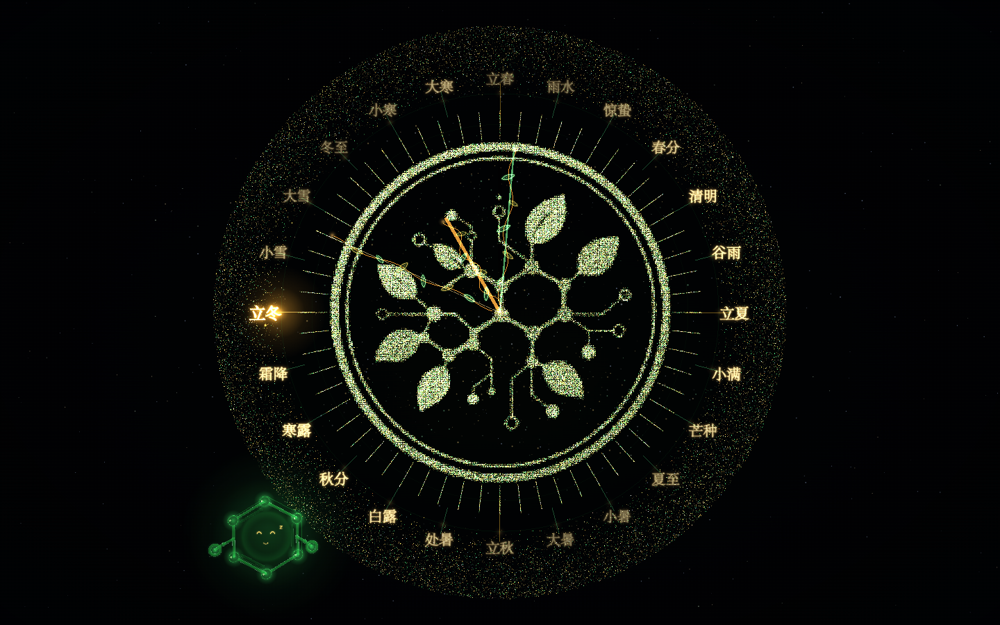
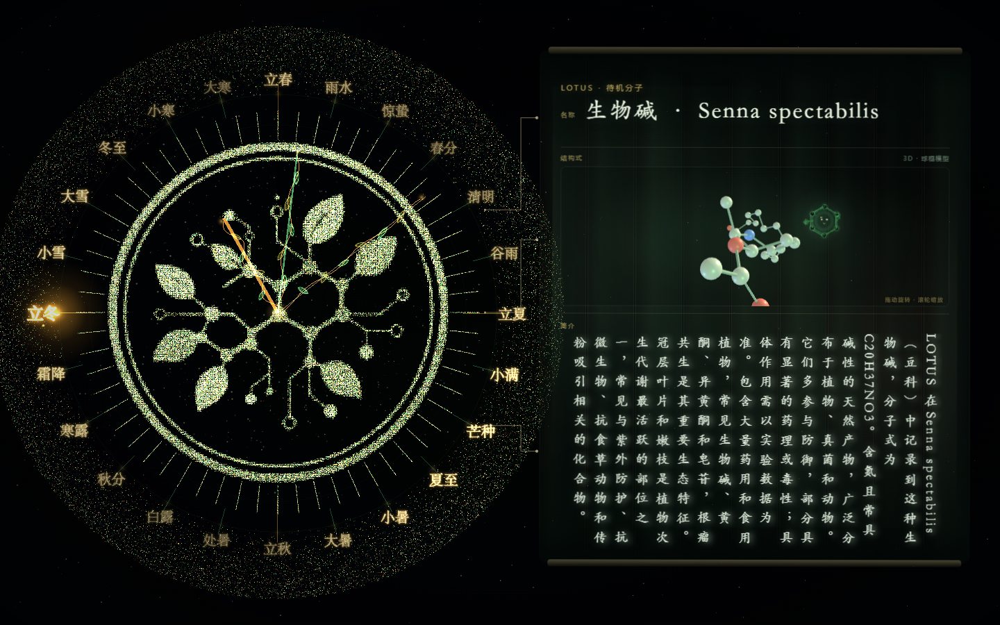

# 天然产物 · 世界树

一棵由 LOTUS 天然产物结构组成的 WebGL 星点世界树。

面向天然产物学习、科学传播与数据探索的 Web 应用。

每一颗星是一个天然产物结构；树冠、树干、根际与土壤对应来源生物的生态位置。可以缩放、检索、点亮、连线，也可以领养一颗属于自己的分子。

站内 AI 分析坞不是普通聊天框：它直接查询 LOTUS 数据、检索知识库、读论文、识图、画图，并驱动 3D 场景。所有数字都走工具，关键结论都给出来源。

**在线体验：** <http://play.simpfun.cn:41018/>







> 仅作科学传播与教学演示，**不构成任何用药建议**。

---

## AI 分析

打开页面底部的 AI 分析坞，直接问：

```text
哪个科的黄酮最多？画分布图，并带我去看。
```

```text
检索 quercetin 近五年的论文，优先 Nature，给出标题、期刊、年份和 DOI。
```

```text
上传一张植物照片或结构式，判断可能的科/分子，查 LOTUS、找相似分子，并说明不确定性。
```

能力一览：

- **数据分析**：LOTUS 227,319 条记录的真实查询、聚合、图表与 3D 定位，数字不靠模型记忆。
- **RAG 溯源**：系统知识库（LOTUS 卡片 / 论文 / 权威网站）+ 用户上传 PDF/Word/Excel/PPT/CSV，回答标注《文件名》第 N 段或 DOI/URL。
- **研究任务**：计划 → 工具执行 → 反思 → 结论，可导出 Markdown 研究简报，可「继续上次」。
- **多模态**：图片先结构化（主体 / 科属候选 / 分子候选 / 置信度 / 不确定项），再自动查 LOTUS、找相似、画分布图。
- **外部文献**：OpenAlex / Crossref / Europe PMC / Nature 直接检索；知网、万方、Web of Science 提供官方检索入口，不抓取受限全文。
- **可停止**：点「■」会同时中止浏览器请求和服务端模型/工具调用。

架构与演示材料：

- [`docs/AI-ARCHITECTURE.md`](docs/AI-ARCHITECTURE.md)：AI 架构、研究任务、多模态、RAG 与文献检索流程图
- [`docs/DEMO-SCRIPTS.md`](docs/DEMO-SCRIPTS.md)：2–3 分钟演示脚本
- [`docs/rag-eval.md`](docs/rag-eval.md)：30 题检索评测与 Cite@4
- [`docs/PERFORMANCE.md`](docs/PERFORMANCE.md)：运行指标与测量方法

---

## 特性

- **AI 分析坞**：数据查询、图表、3D 定位、RAG 引用、论文检索、识图、研究任务与研究简报，全部通过工具和来源约束。
- **星点世界树**：约 22.7 万个 LOTUS 结构点，按生态层位分布，支持旋转、缩放、惯性拖动和第一人称漫游。
- **二十四节气环**：地面节气刻度；生长入场时指针绕场一周，刻线逐条伸向节气文字。
- **季节花瓣**：樱花、油菜花、银杏每次刷新随机出现一种，背景大花瓣 + 前景极淡花瓣。
- **土壤长链烷烃**：从 LOTUS 的饱和无环烷烃库随机抽取，像蚯蚓一样浮现、翻动、消失。
- **闲置钟表**：长时间无交互时，全部树点沿弧线成群飞散，重组成表盘；二十四节气环立起成为 24 格刻度，生成时/分/秒针。表盘底纹由星点按站点徽标的明暗遮罩采样组成。
- **分子详情**：名称、分子式、质量、XLogP、环数、HBD/HBA、TPSA、分类、来源物种、生态说明与 LOTUS 来源。
- **结构式**：按需加载 RDKit.js，在浏览器内计算并渲染暗色结构式。
- **待机 3D 分子**：从 LOTUS SMILES 离线生成 3D 构象，在待机介绍卡里显示球棍模型；拖动旋转、滚轮缩放不会退出世界树，点击 3D 视口外才返回。未生成 3D 的分子自动回退 2D 结构式。
- **领养**：每颗分子只能被领养一次；可留名或匿名显示“神秘用户”；同一访客可领养多颗、可改名。领养信息只在该分子卡片中可见。
- **探索工具**：搜索、随机漫游、今日分子、类群/层位/化学分类/来源科筛选、附近分子、精选分子、收藏、对比、分享链接、下载资料。
- **响应式**：桌面双栏 + 顶部导航；移动端抽屉式探索栏。大屏按 1440×900 设计稿等比放大界面浮层，WebGL 场景保持全屏。

## 操作

| 操作 | 方式 |
| --- | --- |
| 旋转 | 拖动 |
| 缩放 | 滚轮 / 双指 |
| 平移取景 | WASD |
| 进入/退出第一人称 | `~` 键 |
| 选中分子 | 点击星点 |
| 返回说明 | 详情卡左上角 |
| 全屏 | 加载页 F11 提示 / 点击提示 |

## 本地运行

### 方式 A：完整功能（站点 + 领养 + AI）

需要 Node.js 18+（推荐 22；AI 代理要求 20.12+）。

```bash
./start.sh daemon
# 站点      http://127.0.0.1:5173/
# AI API    http://127.0.0.1:5173/api/ai/health
# 领养 API  http://127.0.0.1:5173/api/claim/health
./start.sh status
./start.sh stop
```

`start.sh` 会同时启动静态站、内部领养服务和 AI 代理，并自动复用已运行的服务。Windows 使用 `start-windows.cmd`，同样会启动三个服务。

只想单独调试 AI：`./start-ai.sh`（Windows 用 `start-ai.cmd`）；暂时不启动 AI：`AI_DISABLED=1 ./start.sh`。

### AI 分析

1. 在 `ai/.env` 填写 DS / DS Pro / DS Flash / GLM / MiMo 的 API Key（也可以启动后在右上角 ⚙ → AI / API 里填；「服务商」和「常用向量」下拉会预填 Base URL / 模型）
2. 直接运行 `./start.sh daemon`（Windows 用 `start-windows.cmd`），AI 代理会一并启动；站点把 `/api/ai` 代理到本机 `8790`
3. 打开页面底部 AI 分析坞，或右上角 ⚙ 配置服务商 / Base URL / 模型 / Key；同一面板的「多模态 / 视觉模型」可单独配置识图模型，并点「测试识图」验证
4. 知识库分两层：内置的 **LOTUS 数据集卡片 + 开发参考论文 + 权威网站**（`data/kb-seed/`，不可删除），以及你上传的 PDF / Word / CSV；回答会自动检索并标注《文件名》第 N 段、论文 DOI 或网站 URL
5. 识图：在 AI 坞点「识图」上传结构式、图表或照片。视觉模型只输出结构化 JSON（主体、科属候选、分子候选、结构特征、置信度、不确定项），服务端再自动查 LOTUS、找相似分子、画分类分布并定位场景；低置信度候选不会自动查库。可在右上角 ⚙ →「多模态 / 视觉模型」里单独配置并测试
6. 研究任务：点输入框旁「研究」，AI 先给出 2–4 步计划，再逐步调用工具；结束后由服务端生成研究反思（失败、空结果、缺来源、图片不确定），并导出包含计划、结论、反思、工具记录、图表数据和来源的 Markdown 简报。最近一次研究会保存在本机浏览器，可用「继续上次」恢复
7. 向量模型可与对话模型分开配置：可用 SiliconFlow `https://api.siliconflow.cn/v1` + `BAAI/bge-m3`（免费档，需实名认证），或智谱 `https://open.bigmodel.cn/api/paas/v4` + `embedding-3`（需单独开通 Embedding 资源包）；切换后点知识库面板「重建向量」，再用 `node scripts/rag-eval.mjs` 跑检索评测
8. 运行指标：`GET /api/ai/metrics` 返回对话数、模型调用耗时、工具成功率、视觉与文献检索次数，不含问题正文和 Key，可直接作为参赛材料的量化证据

AI 代理没有 npm 依赖；相似分子索引已生成在 `data/similarity/`，可用 `pipeline/build-molecule-similarity.py` 重建。内置知识库种子在 `data/kb-seed/`（随仓库提交），运行时正文和向量存在本机 `data/kb/`，已在 `.gitignore` 中忽略。详见 [`ai/README.md`](ai/README.md)、[`docs/AI-ARCHITECTURE.md`](docs/AI-ARCHITECTURE.md) 和 [`data/kb-seed/README.md`](data/kb-seed/README.md)。

### 方式 B：只预览前端

```bash
python -m http.server 5173
# http://127.0.0.1:5173/
```

Three.js 与 addons 已放在 `vendor/three/`，页面不再依赖 unpkg 等外网 CDN；更新 Three 后执行：

```bash
npm run vendor:three
```

如果同时需要领养，再开一个终端：

```bash
node deploy/claim-server.mjs
# 本机 localhost:5173 会直连 127.0.0.1:8788/api
```

## 服务器 / 面板部署

完整的部署、备份、回滚、零环境应急与排障手册见 [`docs/DEPLOYMENT_HANDOVER.md`](docs/DEPLOYMENT_HANDOVER.md)。

如果拿到的是校园离线一体包，先看包内 `README-FIRST.md`，解压后执行 `./install-offline.sh`。

推荐直接使用根目录脚本。默认**前台运行**，适合 Docker / 面板托管，进程不会退出。

```bash
chmod +x start.sh
./start.sh
```

其它命令：

```bash
./start.sh daemon   # 后台运行
./start.sh status
./start.sh stop
./start.sh restart
```

### 端口

只公开一个端口：

| 用途 | 默认 | 说明 |
| --- | --- | --- |
| 站点 + `/api` | `5173` | 对外访问 |
| 领养服务 | `8788` | 只绑定 `127.0.0.1`，由站点同源代理 |

- 面板若注入 `$PORT`，脚本会优先使用它。
- 也可以显式指定：

```bash
SITE_PORT=41018 ./start.sh
```

- 对外只需放行站点端口；**不需要暴露 8788**。
- 同源领养地址：`http://<你的地址>:<端口>/api/claim/health`。

### Node / mise

- 项目 `.mise.toml` 固定 `node = "22.14.0"`。
- 如果服务器的 mise `node` shim 尚未配置版本，`start.sh` 会尝试：
  1. 查找 mise / nvm 已安装的真实 Node；
  2. `mise install node@22.14.0`；
  3. `mise use -g node@22.14.0`；
  4. 重新进入脚本继续启动。

手工兜底：

```bash
mise use -g node@22.14.0
```

## 数据

- 结构、生物来源、分类、分子式、SMILES、描述符等均来自 **LOTUS Initiative frozen export 260413（CC0）**。
- 快照约 **227,319** 条结构记录、**1,602** 个物种节点、**2,038** 个精选分子。
- 元数据按 InChIKey 前两位分片压缩存放在 `data/molecules/`，按需加载。
- 3D 构象按同样规则分片存放在 `data/molecules3d/`，由 LOTUS SMILES 经 RDKit ETKDG 离线生成；按需加载，缺失时回退 2D。
- 全量 3D 分片约 60–80MB；生成耗时较长，建议单独同步到服务器，是否纳入 Git 视仓库体积自行决定。
- 分类/来源科 facets 与合法 InChIKey 集合见 `data/molecules/facets.json.gz`。
- 土壤长链烷烃池见 `data/curated/soil-alkanes.json`。
- 数据字段说明：`data/molecules/README.md`。

重建元数据：

```bash
python pipeline/build-molecule-meta.py
python pipeline/build-molecule-facets.py
python pipeline/build-soil-alkanes.py
# 3D 构象（可先用 --prefixes AA,AB 小范围试跑）
python pipeline/build-molecule-3d.py --workers 12
```

依赖 Python 3.10+、RDKit。原始 LOTUS 文件不随仓库分发，脚本默认读取：

```text
19360665/260413_frozen_metadata.csv.gz
```

## 领养服务

领养服务是零依赖 Node HTTP 服务：

- 一个 InChIKey 只能被领养一次；
- 同一 visitor token 可以领养多颗并改名；
- 名字留空显示“神秘用户”；
- 只保存 key、公开显示名、时间、visitor token 的 SHA-256；
- 不保存 IP / UA / 邮箱；
- 事件写入 `claims.jsonl`，已在 `.gitignore` 中忽略。

接口与部署细节见 [`deploy/CLAIM.md`](deploy/CLAIM.md)。

```text
GET   /api/claim?key=<InChIKey>&visitor=<token>
POST  /api/claim       { key, name, visitor }
PATCH /api/claim       { key, name, visitor }
GET   /api/claim/health
```

## 项目结构

```text
index.html                  页面骨架 / 加载页
css/styles.css              全部界面样式
src/main.js                 启动流程、数据装配、UI 挂载
src/scene/TreeScene.js      星点树、相机、节气环、花瓣、烷烃、闲置钟表
src/engine/                 LOTUS 元数据、facets、3D 构象、点位、领养客户端
src/ui/                     详情卡、探索栏、底栏、搜索、引导、对比、SMILES、3D 分子
src/data/                   节气、分类中文信息
data/curated/               精选节点、结构云、土壤烷烃池
data/molecules/             LOTUS 元数据分片 + facets
data/molecules3d/           LOTUS 3D 构象分片（RDKit ETKDG）
vendor/rdkit/               RDKit.js 与 WASM（BSD）
deploy/                     静态站、领养服务、部署说明
pipeline/                   数据构建脚本
start.sh                    一键启动（站点 + 领养 + AI）
```

## 技术栈

- Three.js r169：Points + 自定义 ShaderMaterial、EffectComposer / UnrealBloom、轨道相机
- RDKit.js：SMILES 解析与 2D 结构渲染
- 原生 ES Modules / Canvas / WebGL，无前端构建步骤
- Node.js 零依赖 HTTP：静态站、`/api` 代理、领养服务
- Python + RDKit：LOTUS 数据清洗与压缩分片

## 原创性与许可

- 本项目为独立开发的 Web 应用与 AI 分析系统：界面、场景、AI 工具层、研究任务流程、RAG 管线和文档均为原创。
- 站点徽标、加载动画和世界树造型自制或程序化生成，不包含其他学校、机构或商业品牌标识。
- 代码以 **MIT License** 发布，见 [`LICENSE`](LICENSE)。
- **LOTUS** 数据：CC0；请同时引用其论文与数据快照。
- **RDKit.js / RDKit**：BSD 3-Clause，见 `vendor/rdkit/README.md`。
- **Three.js**：MIT；**MediaPipe Tasks Vision**：Apache 2.0。
- 第三方数据、软件与参考论文的完整声明见 [`NOTICE.md`](NOTICE.md)。
- 本项目不提供医学、药学或用药建议。
