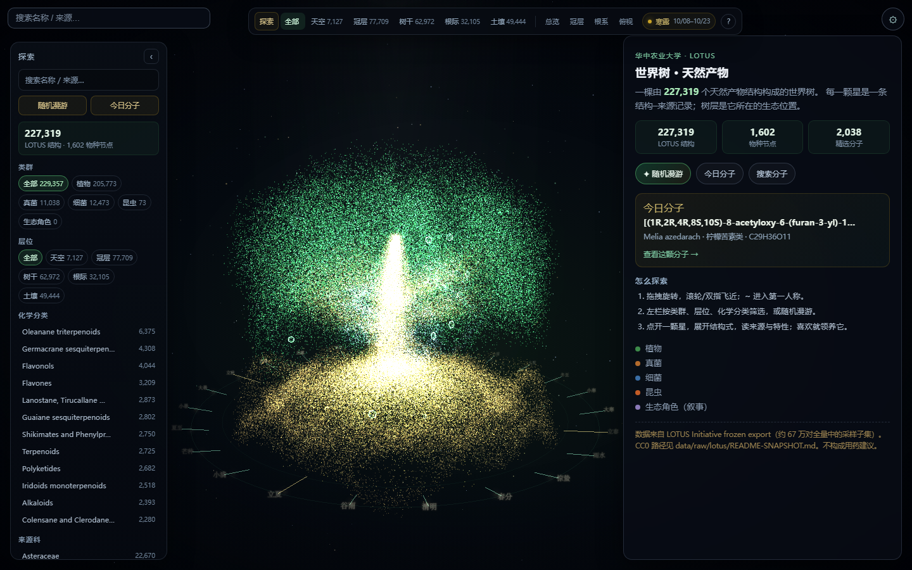
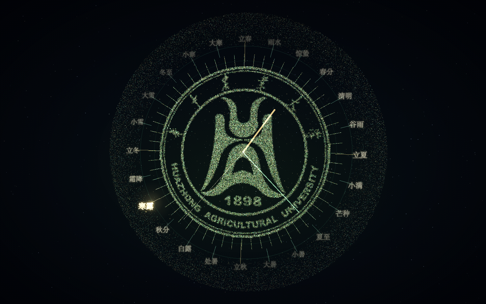
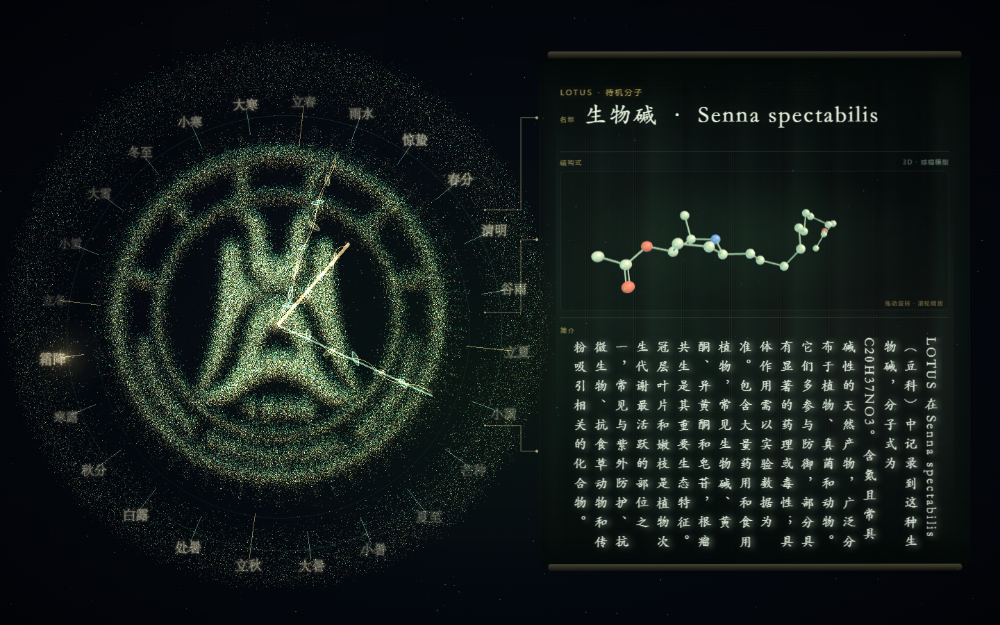

# 天然产物 · 世界树

一棵由 LOTUS 天然产物结构组成的 WebGL 星点世界树。

课程作业，以宣传化学内容为主。

每一颗星是一个天然产物结构；树冠、树干、根际与土壤对应来源生物的生态位置。可以缩放、检索、点亮、连线，也可以领养一颗属于自己的分子。

**在线体验：** <http://play.simpfun.cn:41018/>







> 仅作科学传播与教学演示，**不构成任何用药建议**。

---

## 特性

- **星点世界树**：约 22.7 万个 LOTUS 结构点，按生态层位分布，支持旋转、缩放、惯性拖动和第一人称漫游。
- **二十四节气环**：地面节气刻度；生长入场时指针绕场一周，刻线逐条伸向节气文字。
- **季节花瓣**：樱花、油菜花、银杏每次刷新随机出现一种，背景大花瓣 + 前景极淡花瓣。
- **土壤长链烷烃**：从 LOTUS 的饱和无环烷烃库随机抽取，像蚯蚓一样浮现、翻动、消失。
- **闲置钟表**：长时间无交互时，全部树点沿弧线成群飞散，重组成表盘；二十四节气环立起成为 24 格刻度，生成时/分/秒针。表盘底纹由星点按华中农业大学校徽的明暗遮罩采样组成。
- **分子详情**：名称、分子式、质量、XLogP、环数、HBD/HBA、TPSA、分类、来源物种、生态说明与 LOTUS 来源。
- **结构式**：按需加载 RDKit.js，在浏览器内计算并渲染暗色结构式。
- **待机 3D 分子**：从 LOTUS SMILES 离线生成 3D 构象，在待机介绍卡里显示球棍模型；拖动旋转、滚轮缩放不会退出世界树，点击 3D 视口外才返回。未生成 3D 的分子自动回退 2D 结构式。
- **领养**：每颗分子只能被领养一次；可留名或匿名显示“神秘用户”；同一访客可领养多颗、可改名。领养信息只在该分子卡片中可见。
- **探索工具**：搜索、随机漫游、今日分子、类群/层位/化学分类/来源科筛选、附近分子、精选分子、收藏、对比、分享链接、下载资料。
- **响应式**：桌面双栏 + 顶部导航；移动端抽屉式探索栏。

## 操作

| 操作 | 方式 |
| --- | --- |
| 旋转 | 拖动 |
| 缩放 | 滚轮 / 双指 |
| 平移取景 | WASD |
| 进入/退出第一人称 | `~` 键 |
| 选中分子 | 点击星点 |
| 返回说明 | 详情卡左上角 |
| 全屏 | 加载页 F11 提示 / 点击提示 |

## 本地运行

### 方式 A：完整功能（含领养）

需要 Node.js 18+（推荐 22）。

```bash
./start.sh daemon
# 站点      http://127.0.0.1:5173/
# 领养 API  http://127.0.0.1:5173/api/claim/health
./start.sh status
./start.sh stop
```

`start.sh` 会同时启动静态站和内部领养服务，并自动复用已运行的服务。

### 方式 B：只预览前端

```bash
python -m http.server 5173
# http://127.0.0.1:5173/
```

Three.js 与 addons 已放在 `vendor/three/`，页面不再依赖 unpkg 等外网 CDN；更新 Three 后执行：

```bash
npm run vendor:three
```

如果同时需要领养，再开一个终端：

```bash
node deploy/claim-server.mjs
# 本机 localhost:5173 会直连 127.0.0.1:8788/api
```

## 服务器 / 面板部署

推荐直接使用根目录脚本。默认**前台运行**，适合 Docker / 面板托管，进程不会退出。

```bash
chmod +x start.sh
./start.sh
```

其它命令：

```bash
./start.sh daemon   # 后台运行
./start.sh status
./start.sh stop
./start.sh restart
```

### 端口

只公开一个端口：

| 用途 | 默认 | 说明 |
| --- | --- | --- |
| 站点 + `/api` | `5173` | 对外访问 |
| 领养服务 | `8788` | 只绑定 `127.0.0.1`，由站点同源代理 |

- 面板若注入 `$PORT`，脚本会优先使用它。
- 也可以显式指定：

```bash
SITE_PORT=41018 ./start.sh
```

- 对外只需放行站点端口；**不需要暴露 8788**。
- 同源领养地址：`http://<你的地址>:<端口>/api/claim/health`。

### Node / mise

- 项目 `.mise.toml` 固定 `node = "22.14.0"`。
- 如果服务器的 mise `node` shim 尚未配置版本，`start.sh` 会尝试：
  1. 查找 mise / nvm 已安装的真实 Node；
  2. `mise install node@22.14.0`；
  3. `mise use -g node@22.14.0`；
  4. 重新进入脚本继续启动。

手工兜底：

```bash
mise use -g node@22.14.0
```

## 数据

- 结构、生物来源、分类、分子式、SMILES、描述符等均来自 **LOTUS Initiative frozen export 260413（CC0）**。
- 快照约 **227,319** 条结构记录、**1,602** 个物种节点、**2,038** 个精选分子。
- 元数据按 InChIKey 前两位分片压缩存放在 `data/molecules/`，按需加载。
- 3D 构象按同样规则分片存放在 `data/molecules3d/`，由 LOTUS SMILES 经 RDKit ETKDG 离线生成；按需加载，缺失时回退 2D。
- 全量 3D 分片约 60–80MB；生成耗时较长，建议单独同步到服务器，是否纳入 Git 视仓库体积自行决定。
- 分类/来源科 facets 与合法 InChIKey 集合见 `data/molecules/facets.json.gz`。
- 土壤长链烷烃池见 `data/curated/soil-alkanes.json`。
- 数据字段说明：`data/molecules/README.md`。

重建元数据：

```bash
python pipeline/build-molecule-meta.py
python pipeline/build-molecule-facets.py
python pipeline/build-soil-alkanes.py
# 3D 构象（可先用 --prefixes AA,AB 小范围试跑）
python pipeline/build-molecule-3d.py --workers 12
```

依赖 Python 3.10+、RDKit。原始 LOTUS 文件不随仓库分发，脚本默认读取：

```text
19360665/260413_frozen_metadata.csv.gz
```

## 领养服务

领养服务是零依赖 Node HTTP 服务：

- 一个 InChIKey 只能被领养一次；
- 同一 visitor token 可以领养多颗并改名；
- 名字留空显示“神秘用户”；
- 只保存 key、公开显示名、时间、visitor token 的 SHA-256；
- 不保存 IP / UA / 邮箱；
- 事件写入 `claims.jsonl`，已在 `.gitignore` 中忽略。

接口与部署细节见 [`deploy/CLAIM.md`](deploy/CLAIM.md)。

```text
GET   /api/claim?key=<InChIKey>&visitor=<token>
POST  /api/claim       { key, name, visitor }
PATCH /api/claim       { key, name, visitor }
GET   /api/claim/health
```

## 项目结构

```text
index.html                  页面骨架 / 加载页
css/styles.css              全部界面样式
src/main.js                 启动流程、数据装配、UI 挂载
src/scene/TreeScene.js      星点树、相机、节气环、花瓣、烷烃、闲置钟表
src/engine/                 LOTUS 元数据、facets、3D 构象、点位、领养客户端
src/ui/                     详情卡、探索栏、底栏、搜索、引导、对比、SMILES、3D 分子
src/data/                   节气、分类中文信息
data/curated/               精选节点、结构云、土壤烷烃池
data/molecules/             LOTUS 元数据分片 + facets
data/molecules3d/           LOTUS 3D 构象分片（RDKit ETKDG）
vendor/rdkit/               RDKit.js 与 WASM（BSD）
deploy/                     静态站、领养服务、部署说明
pipeline/                   数据构建脚本
start.sh                    一键启动（含领养）
```

## 技术栈

- Three.js r169：Points + 自定义 ShaderMaterial、EffectComposer / UnrealBloom、轨道相机
- RDKit.js：SMILES 解析与 2D 结构渲染
- 原生 ES Modules / Canvas / WebGL，无前端构建步骤
- Node.js 零依赖 HTTP：静态站、`/api` 代理、领养服务
- Python + RDKit：LOTUS 数据清洗与压缩分片

## 许可与致谢

- **LOTUS** 数据：CC0，<https://lotus.naturalproducts.net/>；请同时引用其论文与数据快照。
- **RDKit.js / RDKit**：BSD 许可，见 `vendor/rdkit/README.md`。
- **Three.js**：MIT 许可。
- 华中农业大学校徽版权归华中农业大学所有，本项目仅用于展示性、非商业性的校园科学传播；如需商用请获得学校授权。
- 本项目不提供医学、药学或用药建议。
