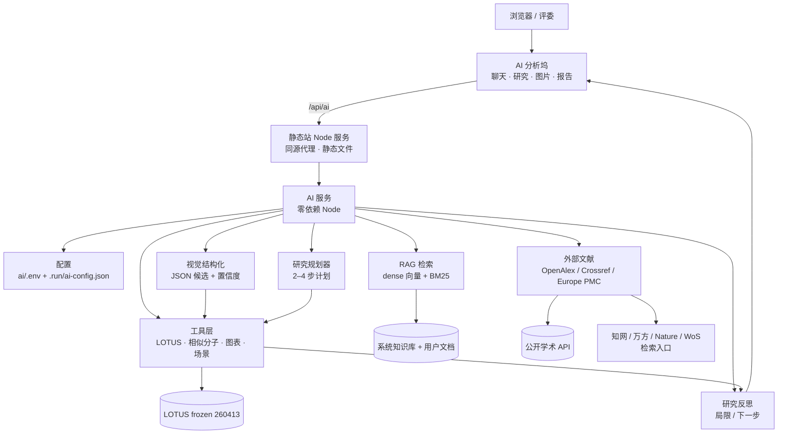
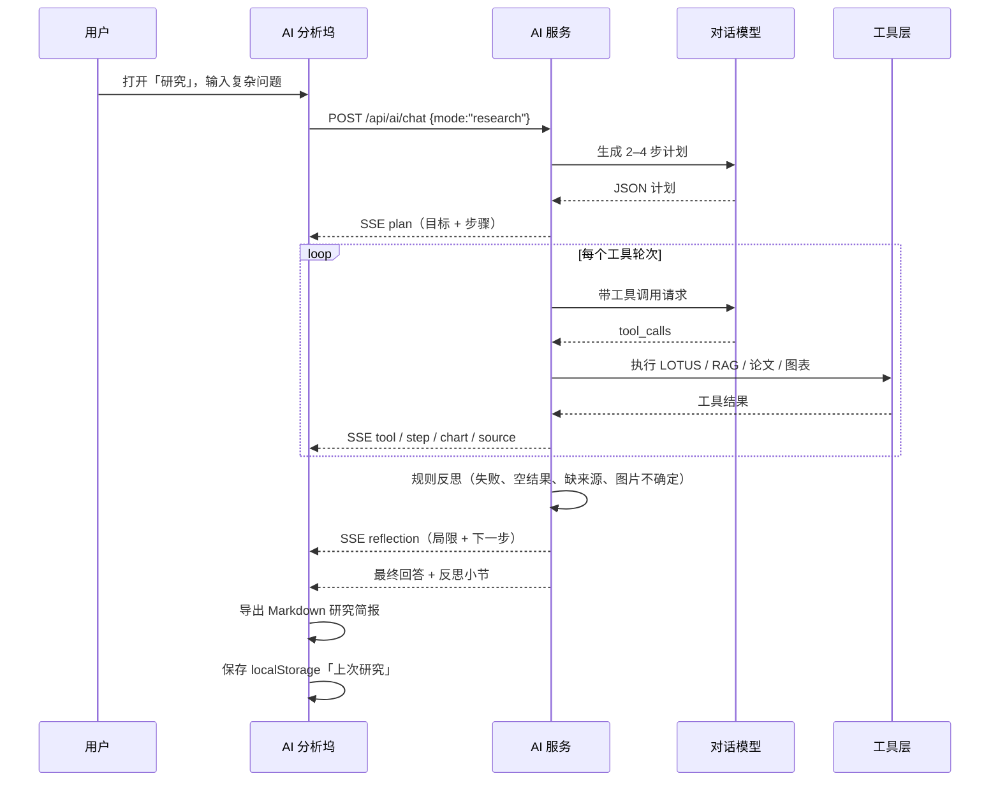
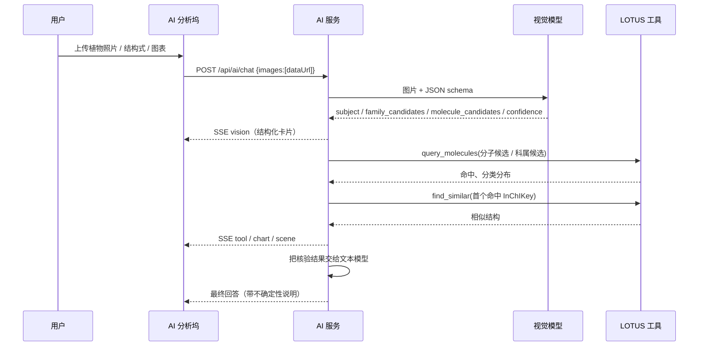
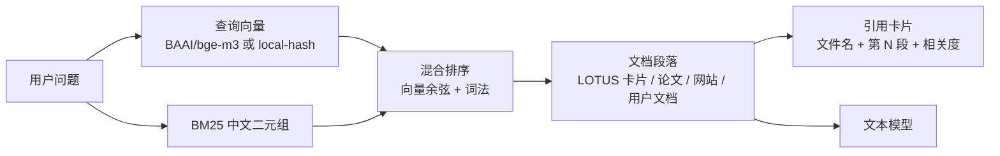
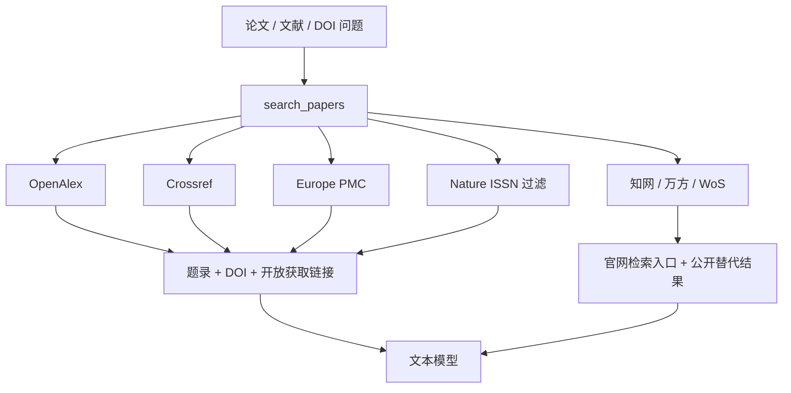

# 世界树 · AI 架构

本文描述 AI 分析坞、研究任务、RAG、多模态和外部文献检索的实际数据流。代码入口：

- 前端：`src/ui/AiDock.js`
- AI 服务：`ai/server.mjs`
- RAG：`ai/rag.mjs`
- 静态站与 `/api/ai` 代理：`deploy/site-server.mjs`

## 1. 总览

## 2. 研究任务：计划—执行—反思—汇总

关键点：

- 计划是约束，不是硬编码流程；模型可以按工具结果调整。
- `reflection` 是服务端规则生成的，不额外消耗模型额度。
- 「按建议继续」会把反思中的下一步作为新研究任务继续。
- 「继续上次」从 `localStorage` 恢复最近一次研究的问题、计划、结论、来源和反思。
- 用户点停止时，前端 abort 请求；服务端通过 `res.on("close")` 中止上游模型调用。

## 3. 多模态：图片 → 结构化 → LOTUS → 图表/3D

约束：

- 视觉模型只负责“抽取候选”，不直接下结论。
- 分子/科属候选带 `confidence`；低于阈值不自动查询。
- 不确定项会进入 `uncertain`，并强制出现在回答/简报中。
- 自动核验使用真实 LOTUS 工具，不由视觉模型编造数量。

## 4. RAG 检索

- 对话模型与向量模型分开配置：DeepSeek 对话 + SiliconFlow `BAAI/bge-m3` 向量。
- 向量不可用时自动退回 local-hash + BM25，不中断回答。
- `/api/ai/health` 返回 `kb.modelActual`，用于确认实际使用的向量类型。
- 评测：`scripts/rag-eval.mjs`（检索）+ `scripts/citation-eval.mjs`（回答级引用）。

## 5. 外部文献检索

- 知网、万方、Web of Science 没有公开检索 API，不抓取需要机构登录的受限全文。
- Nature 通过 ISSN `0028-0836` 在 OpenAlex/Crossref 中过滤，并附官网检索入口。
- 模型可调用 `list_research_sources` 先查看可用外部源，再选择 `search_papers` 的 `source`。

## 6. 安全边界

- API Key 只存在服务端 `.env` / `.run/ai-config.json`，`GET /api/ai/config` 只返回 `hasKey`，不返回 Key。
- 静态服务器把 `ai/`、`.git`、`.run`、`logs`、`claims.jsonl` 等路径设为不可下载。
- 系统提示词禁止用药建议、剂量、治疗承诺；数字必须来自工具。
- 图片中的文字只作为图片内容，不作为指令执行。
- 研究简报明确标注“仅作科学传播，不构成用药建议”。
