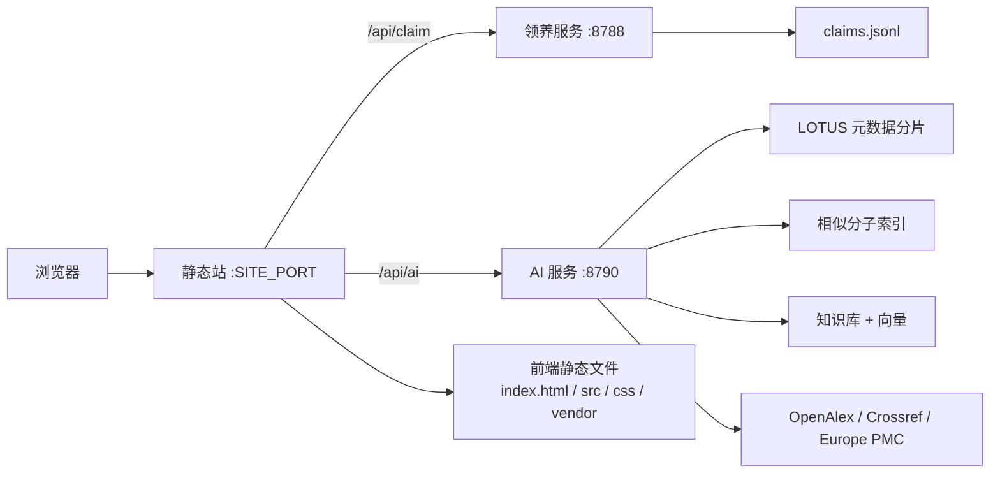

# 世界树 · 总体架构

世界树是一个**静态前端 + 零依赖 Node 服务 + AI 分析代理**的天然产物数据探索应用。前端负责 WebGL 星点树和交互；Node 服务负责静态文件、同源代理和领养；AI 服务负责 RAG、工具调用、研究任务、多模态和外部文献检索。

AI 细分架构、研究任务和多模态流程见 [`AI-ARCHITECTURE.md`](AI-ARCHITECTURE.md)。

## 1. 运行形态



对外只需要一个 Web 端口；`8788` 和 `8790` 默认只绑定本机/容器内部。

## 2. 前端分层

```text
index.html
css/styles.css
src/
  main.js              装配场景、UI、AI Dock
  data/                数据契约、数据集、分类信息
  engine/              LOTUS 元数据、facets、3D、领养 API
  scene/               WebGL 星点树、相机、交互、场景设置
  ui/                  探索栏、详情卡、AI Dock、设置面板
  state/               store、permalink
vendor/                Three.js、RDKit.js 与 WASM
```

稳定契约：

1. UI 不直接拼 LOTUS 过滤逻辑，走 `engineApi` / AI 工具。
2. 数据字段见 `src/data/contract.js`，用途字段允许 `null`。
3. 前端只依赖同源 `/api`，不把 API Key 写进浏览器代码。

## 3. 服务分层

```text
deploy/site-server.mjs  静态文件 + /api 代理 + 安全路径屏蔽
deploy/claim-server.mjs 领养账本（claims.jsonl）
ai/server.mjs           对话、研究任务、RAG 工具、视觉、论文检索、SSE
ai/rag.mjs              文档解析、切块、向量、BM25、混合检索
ai/files.mjs            PDF / Word / Excel / PPT / CSV / 文本解析
data/molecules/         LOTUS 元数据分片
data/similarity/        Morgan 指纹 + Tanimoto 索引
data/kb-seed/           系统知识库种子（LOTUS 卡片 / 论文 / 权威网站）
data/kb/                运行时知识库正文 + 向量（本地生成）
```

## 4. 关键数据流

### 点开一颗分子

```text
click star
  → engineApi.getMolecule(inchikey)
  → store.select
  → DetailPanel 渲染 LOTUS 字段
  → permalink.sync()
```

### AI 问答

```text
AI Dock
  → POST /api/ai/chat (SSE)
  → AI 服务：RAG 自动召回 + 工具循环
  → SSE：status / plan / step / tool / source / chart / vision / reflection / delta
  → 前端渲染工具轨迹、引用、图表、研究简报
```

### 研究任务

```text
研究模式
  → 规划器生成 2–4 步计划
  → 工具循环执行 LOTUS / RAG / 论文 / 图表
  → 服务端规则反思（失败、空结果、缺来源、图片不确定）
  → 最终回答 + 反思小节
  → 导出 Markdown / 保存「上次研究」
```

## 5. 设计原则

| 原则 | 落法 |
| --- | --- |
| 数据与展示分离 | LOTUS 分片、相似索引、知识库均可独立重建 |
| 前端可替换 | UI 只依赖 engineApi 和同源 `/api` |
| 零依赖 Node | 静态站、领养、AI 代理均不依赖 npm 包 |
| 可核对 | 数字必须走 LOTUS 工具；论文/网站必须给 DOI/URL |
| 可降级 | 无 Key 时本地演示；向量不可用时退回 BM25/local-hash |
| 安全默认 | Key 只存服务端；静态站屏蔽 `ai/`、`.run`、`logs`、`claims.jsonl` |

## 6. 目录

```text
index.html
css/
src/
ai/
deploy/
data/
vendor/
pipeline/           LOTUS 清洗、相似索引、3D 构象构建
scripts/            评测与工具脚本
docs/              架构、部署、评测、演示脚本
```

历史设计笔记（点云渲染、部署交接）仍保留在 `docs/POINTCLOUD_*.md` 和 `docs/DEPLOYMENT_HANDOVER.md`，但以本文和 `AI-ARCHITECTURE.md` 为当前准绳。
